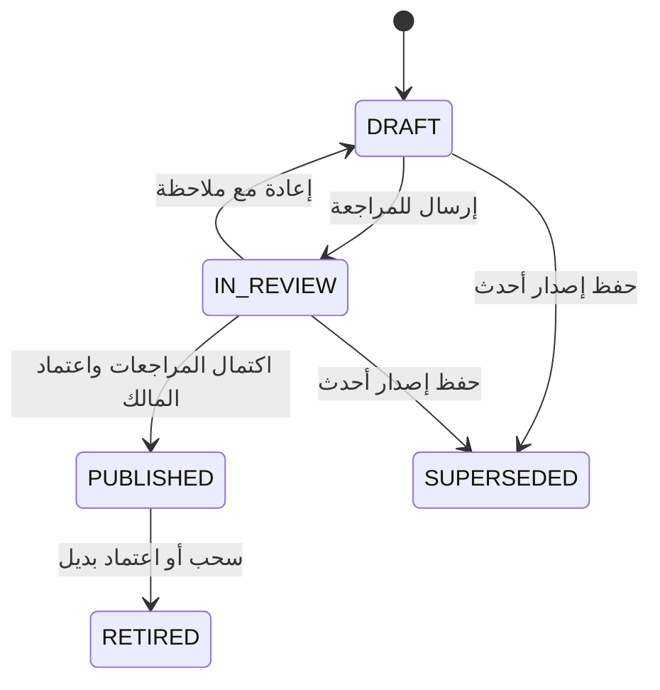

# مكتبة عقود هيدرولاند — تنفيذ للمراجعة

مكتبة مركزية للقوالب الموحدة داخل نظام المستندات القائم. يستطيع المختص تعديل البنود بإصدار جديد، والرجوع إلى النسخ السابقة، وتسجيل المراجعات قبل اعتماد القالب للاستخدام. يستمد عقد تعاون محترف غوص الجديد بنوده من النسخة المعتمدة، ويحفظ نسخة نصية منها ومرجع إصدارها داخل العقد.

## نطاق القوالب الأولية

| القالب | الرمز | المراجعات قبل الاعتماد | مسار الاستخدام |
| --- | --- | --- | --- |
| عقد تعاون محترف غوص | `CLIB-DIVE-COOPERATION` | القانونية ثم اعتماد مالك هيدرولاند | مسار التعاون والتوقيع القائم |
| عقد عمل غير محدد المدة | `CLIB-HR-PERMANENT` | الموارد البشرية والقانونية ثم اعتماد المالك | قالب جاهز للربط بمسار التوظيف |
| عقد عمل مؤقت لمهمة محددة | `CLIB-HR-TEMPORARY` | الموارد البشرية والقانونية ثم اعتماد المالك | قالب جاهز للربط بمسار التوظيف |
| عقد عمل مرن بالأجر الساعي | `CLIB-HR-FLEXIBLE` | الموارد البشرية والقانونية ثم اعتماد المالك | قالب جاهز للربط بمسار التوظيف |

يضيف إجراء التهيئة القوالب الأربعة كمسودات فقط، وبصورة قابلة للتكرار دون إنشاء نسخ مكررة. راجعت صفحات ملفات العقود الثلاثة السابقة كاملة؛ المحتوى المبدئي صياغة معدّة للمراجعة من تلك المسودات، وليس استيراداً حرفياً أو شهادة مطابقة قانونية. تفاصيل الأهلية والحدود الرقمية والتوثيق الرسمي يجب أن يحسمها المختص في المراجعة المحدثة. يمكن نسخ قالب وإعطاؤه اسماً وبنوداً مستقلة لإضافة عائلة عقود أخرى؛ النسخة المستقلة لا تكتسب تلقائياً صلاحية مسار توقيع التعاون.

## قرار البنية المعمارية

لا يضاف جدول قوالب أو سجل موظفين موازٍ. تستعمل المكتبة `DocumentTemplate` بالجهة الداخلية المعتمدة من `PLATFORM_STAFFING_ORGANIZATION:v1`. تحفظ `fields` غلافاً محدد النوع `CONTRACT_LIBRARY_V1` يضم تعريف الحقول، البنود، المصدر، بصمة المحتوى، حالة المراجعة ومراجع القرارات. تظل القوالب التشغيلية الأخرى بمصفوفة الحقول الحالية؛ تُستبعد رموز `CLIB-` من المسارات العامة لمنع تجاوز صلاحيات المكتبة.

| المسؤولية | مصدر الحقيقة |
| --- | --- |
| نص القالب المركزي وإصداراته | `DocumentTemplate` بالجهة الداخلية |
| مراجعات القالب وقرار الاعتماد | غلاف الإصدار و`AuditEvent` في معاملة واحدة |
| العقد المنفذ ونصه المثبت وتوقيعاته | `ManagedDocument` و`DocumentRevision` و`DocumentLifecycleEvent` |
| بيانات المحترف والمركز | ملف العضوية وملف المركز القائمان |
| بيانات الموظف والوظيفة والإدارة | `Employment` و`Account` و`OrgUnit` و`Position` |
| بيانات عقد العمل الوظيفية | `EmploymentContract` لدى الموارد البشرية؛ لا تعدلها المكتبة |

هذا امتداد للملكية المحددة في `ARCHITECTURE_FREEZE_V1.md` و`HR_LEVEL_3_EMPLOYEE_LIFECYCLE.md`، وليس بديلاً عن سجل الالتزامات والتأمين والمطالبات القانونية الذي لم يكتمل تخزينه بعد. لا توجد حاجة إلى ترحيل مخطط إضافي لهذه المكتبة. يبقى ترحيل بيانات مصادر عقد التعاون السابق مستقلاً وخاضعاً لفحص الإصدار الإنتاجي قبل تطبيقه.

## حفظ النسخ والمراجعة

كل تعديل للنص ينشئ صفاً بإصدار أعلى وبصمة جديدة. تبقى النسخة المعتمدة السابقة مستخدمة حتى اعتماد البديل، وتصبح مسحوبة عند إحلال النسخة الجديدة. النسخ المعدة أو المرسلة للمراجعة تصبح إصدارات سابقة عند تعديلها، وتحفظ في السجل. يمكن إعداد إصدار جديد من آخر نسخة مسحوبة دون إعادة تفعيل النص القديم مباشرة.

المراجع مستقل عن محرر الإصدار. تتطلب قوالب الموظفين مراجعة موارد بشرية بالإضافة إلى القانونية. يراجع الاعتماد صلاحيات المراجعين الحالية وبصمة النسخة. إرجاع النسخة يلغي مراجعاتها، وتعديل البنود يلزم مراجعات جديدة. تحفظ الأسباب والمراجع في سجل القرارات. المسودات غير متاحة للأطراف الخارجية، وقوالب الموظفين تبقى داخلية حتى بعد اعتمادها.

لا يمكن إنشاء عقد تعاون من مسودة أو قالب مسحوب، ولا يوجد رجوع صامت إلى البنود البرمجية القديمة. يحمل العقد `librarySource = { templateId, version, contentHash }` ونسخة من البنود ضمن بصمة العقد. يحتفظ المركز بصف ربط صغير في `DocumentTemplate` لتوافق المفتاح الخارجي الحالي؛ تبقى المكتبة المركزية صاحبة النص المعتمد. تحديث القالب لا يعيد كتابة أي عقد سابق أو توقيعاته، وتظل العقود القائمة قابلة للقراءة بعد سحب القالب.

## صلاحيات الإدارات

مالك الجهة الداخلية بحساب إداري نشط وبريد مؤكد يهيئ المكتبة ويعتمد القوالب ويسحبها. مختص القانونية يحتاج وظيفة داخلية نشطة في وحدة `LEGAL_CONTRACTS_INSURANCE` وعضوية داخلية وصلاحية `STAFF` نشطتين. مختص الموارد البشرية يحتاج هذه الشروط في وحدة `HR` بالإضافة إلى `HR_MANAGER` أو `HR_REVIEWER`، ويقتصر تحريره على قوالب الموظفين. الإدارة العامة وحدها أو عضوية إدارة مركز لا تمنح سلطة اعتماد القوالب.

الأطراف المؤهلة لعقد التعاون تقرأ القوالب المعتمدة، دون سجل الملاحظات الداخلية أو معرفات المراجعين. تظهر للمختصين وصلة المكتبة في الملف الشخصي، وتوجد وصلة من مساحة العقود واللوحات المعنية. تمسح الواجهة البيانات عند الخروج أو تغير الدور، وتتجاهل الاستجابات المتأخرة من جلسة سابقة.

## ربط الموارد البشرية

يرجع تعريف قالب الموظف `integration.hr.binding` بالمعرف والإصدار والبصمة، ويحدد `Employment` مصدراً لبيانات العامل. هذه واجهة ربط جاهزة لمسار الموارد البشرية اللاحق، وليست تنفيذاً تلقائياً لعقد عمل أو تعييناً أو تفعيل صلاحيات. يجب أن يتحقق المسار المنفذ من جهة الموظف وحالة وظيفته وصلاحية المختص، وأن يثبت مرجع القالب داخل العقد المنفذ. لا توضع معرفات `ManagedDocument` في `EmploymentContract.documentId`؛ هذا الحقل مرتبط حالياً بكيان `Document` مختلف، ويجب احترام فصل بيانات العقد الوظيفية عن أدلة التوقيع وفق المعمارية.

## واجهة الخدمة

الأساس `/api/v1/contracts/library`، وجميع المسارات محمية بجلسة الدخول.

| الإجراء | المسار |
| --- | --- |
| صلاحيات مساحة العمل | `GET /workspace` |
| بحث وتصنيف وحالة أحدث نسخة | `GET /?q=&category=&state=` |
| إضافة المسودات الأولية | `POST /initialize` |
| عرض إصدار محدد | `GET /:id` |
| الإصدارات السابقة | `GET /:id/history` |
| سجل قرارات الإصدار | `GET /:id/events` |
| حفظ إصدار جديد | `POST /:id/revise` |
| إضافة عائلة مستقلة من قالب | `POST /:id/copy` |
| إرسال أو مراجعة أو اعتماد أو إعادة أو سحب | `POST /:id/decision` |

يحمل كل تعديل وقرار `expectedVersion` و`expectedContentHash`. تسلسل المعاملات قابل لإعادة المحاولة، مع أقفال هوية وحالة الموظف والعضوية والقالب، وصف تسلسل مشترك يمنع تضارب أول إصدار أو عمليتي اعتماد. يفشل الإجراء كله إذا تعذر تسجيل أثر التدقيق.

## التحقق وحدود الإصدار

- اختبارات HTTP فعلية مع Nest والبيانات المعزولة: 93 تحققاً للمكتبة و111 لمسار التعاون بعد ربطه بها. تشمل عدم تسريب قوالب الموظفين، منع المراجعة الذاتية، سحب صلاحية المراجع قبل الاعتماد، حفظ مراجعتَي الموارد البشرية والقانونية، منع المسارات العامة، التعارض بين التعديلات، ثبات العقود السابقة، والتراجع الكامل عند فشل سجل التدقيق.
- اختبارات المتصفح: 10 سيناريوهات للمكتبة، مع مرور 15 سيناريو تعاون ومستندات تشغيلية. شملت حفظ الإصدار، الرجوع للنص السابق، البحث والتصنيف، قرار الاعتماد، عرض الجوال، وسحب الصلاحيات والخروج والاستجابة المتأخرة. اكتشف اختبار التصنيف خطأ في خيارات القائمة وصحح قبل التحقق النهائي.
- بناء API، فحص الأنواع، تحقق مخطط Prisma، صلاحيات المستندات، الوصول المحدود للمراكز، واختبارات وبناء الويب.
- محلياً استعملت الاختبارات PGlite المعزول؛ اختبار تنافس أقفال PostgreSQL 16 الأصلي مدرج في GitHub Actions ويظل مطلوباً قبل الدمج. لا تدعي هذه النتائج نشر التغيير أو تشغيله على Render.
- كود المكتبة ومسوداتها جاهزان للمراجعة المحلية. لم تطبق تهيئة أو ترحيلات أو عقود أو صلاحيات على الإنتاج. عند النشر المصرح به: تراجع بوابة الإصدار والترحيل السابق، ثم يضيف المالك القوالب كمسودات، ويستكمل المختصون المراجعات الفعلية والاعتماد داخل النظام.
